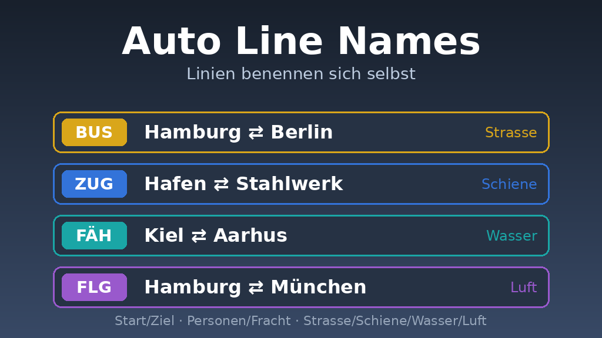

# FT3Mods

Mods für Transport Fever 3

---

## Auto Line Names (`tf3_auto_line_names`)

Benennt Linien automatisch nach Start und Ziel, zum Beispiel "Hamburg ⇄ Berlin". Der Name zeigt außerdem, ob es eine Personen- oder Frachtlinie ist und ob sie über Strasse, Schiene, Wasser oder Luft läuft. Von Hand benannte Linien werden nie angefasst.

Benennt Linien automatisch nach Start/Ziel, Personen/Fracht und Strasse/Schiene/Wasser/Luft.

**Status:** ungetestet in TF3: Game-Script-Registrierung ist im TF3-Wiki noch nicht dokumentiert.

### Installation
Ordner `tf3_auto_line_names` in den `mods`-Ordner von TF3 kopieren.

### Einstellungen
In `content/scripts/linenamer_config.lua`.

### Probelauf
`dryRun = true` setzen: die Mod schreibt nur ins Log (`stdout.txt`, Zeilen mit `[AutoLineNames]`), was sie umbenennen wuerde.
